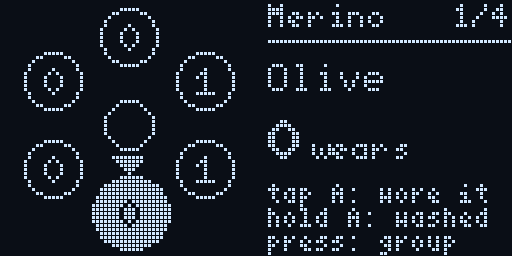
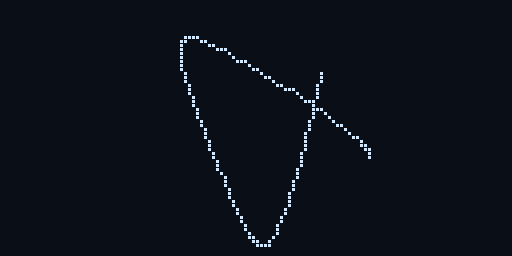
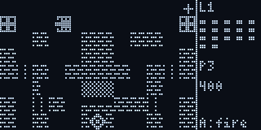
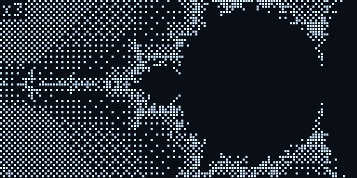
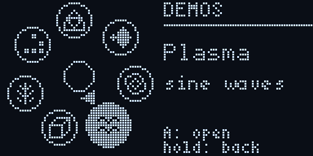
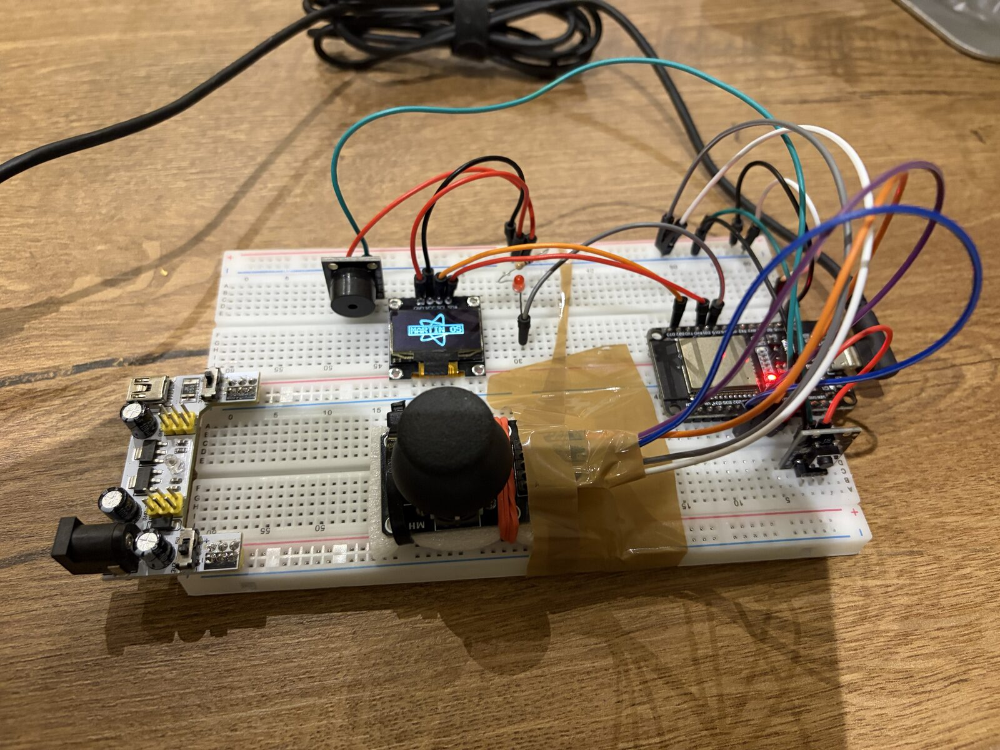

# embedded-lab

Microcontroller experiments: an ESP32 on a breadboard with a thumb joystick,
a button, a 0.96" OLED and a buzzer, and whatever else ends up wired to it.
Every project is its own [PlatformIO](https://platformio.org) project, and
most of the code was written together with an AI coding agent
(see [AGENTS.md](AGENTS.md)).

The big one is **Martin OS**: a home station for the desk, with a clothes
wear counter, seven small games and a folder of math demos.

<p align="center">
  
</p>

Every animation on this page is a real recording: the board streams its
screen buffer over USB while you play ([how](#recording-the-screen)).

## Martin OS

[`projects/martin-os`](projects/martin-os) · ESP32 · 128x64 OLED · joystick + 1 button

- **One-thumb UI.** Everything sits on a ring. Point the stick at an item and
  a compass needle swings after it. Rings spiral out of the middle when they
  open and back in when they close.
- **Wear counter.** Counts how often each shirt, pair of trousers or pillowcase
  has been worn since its last wash. Tap to count, hold to wash one item, keep
  holding to wash the whole group: the ring spins up like a washing machine,
  then blows up into soap bubbles with a fanfare. Counts survive power cuts (NVS).
- **Games.** Dodge, Snake, Maze 3D (raycaster), Crypt (a first-person shooter
  with generated rooms), Bricks, Stacker and Tanks. All levels are generated.
- **Demos.** Math animations, rendered live on the chip.

<table>
  <tr>
    <td align="center"><br><sub><b>Boot</b>: a spirograph (hypotrochoid)<br>draws itself, then the home ring opens</sub></td>
    <td align="center"><br><sub><b>Tanks</b>: defend the core in a<br>generated fort; bricks can be shot away</sub></td>
  </tr>
  <tr>
    <td align="center"><br><sub><b>Mandelbrot</b>: dives 50,000x, on both CPU cores,<br>greys by ordered dithering</sub></td>
    <td align="center"><br><sub><b>Tunnel</b>: nested polygons, each inscribed<br>in the last, so the zoom never ends</sub></td>
  </tr>
  <tr>
    <td align="center" colspan="2"><br><sub><b>Solids</b>: perspective wireframes, up to a 4D tesseract</sub></td>
  </tr>
</table>

Also in Demos: a morphing Julia set, a demoscene plasma, the chaos game
(Barnsley's fern, Sierpinski, dragon curve) and Conway's Game of Life.
The [Martin OS README](projects/martin-os/README.md) has every control and the
code layout.

## Hardware

<p align="center">
  
</p>

Playing it on the real board (the repo is open on the laptop behind it):

https://github.com/user-attachments/assets/57fbac8a-5644-4b75-b347-f76c22c51a07

| Part | Pins |
|---|---|
| ESP32 DevKit V1 clone (ESP-WROOM-32, 30 pins) | |
| SSD1306 0.96" OLED, I2C, 0x3C | SDA GPIO21, SCL GPIO22, powered from 3V3 |
| KY-023 analog joystick | VRX GPIO32, VRY GPIO33, SW GPIO25, powered from 3V3 |
| KY-004 push button ("A") | S GPIO26 |
| HW-508 passive buzzer | S GPIO27 |

Two breadboards, jumper wires, no soldering.
[`hardware.md`](hardware.md) has the full wiring, the board's pin-out, the
ESP32 pin rules (strapping pins, ADC2 and Wi-Fi, input-only pins) and a
procedure for rewiring safely.

## Building and flashing

You need PlatformIO Core. Every version is pinned, so builds stay
reproducible.

```sh
uv tool install platformio          # or pipx install platformio
cd projects/martin-os
pio run -t upload                   # build and flash
"$(uv tool dir)/platformio/bin/python" ../../scripts/serial-log.py --seconds 10
```

## Recording the screen

[`scripts/oled-capture.py`](scripts/oled-capture.py) asks the board for its
screen. Martin OS then switches its serial port to 460800 baud and streams
every frame: a 1 KB buffer with a checksum, about 22 ms each, sent in the
background so the game keeps its 24 fps. The script draws each frame as OLED
pixels with a dark gap between them and writes PNGs or GIFs (via ImageMagick).

```sh
"$(uv tool dir)/platformio/bin/python" scripts/oled-capture.py --seconds 15 --gif clip.gif
# or record once, then cut clips from it
"$(uv tool dir)/platformio/bin/python" scripts/oled-capture.py --seconds 240 --save tour.bin
"$(uv tool dir)/platformio/bin/python" scripts/oled-capture.py --load tour.bin --start 39 --end 53 --gif wear.gif
```

## Layout

| Path | What |
|---|---|
| [`projects/martin-os`](projects/martin-os) | The home station: ring UI, Wear, games, demos |
| [`projects/joystick-oled`](projects/joystick-oled) | Hardware test for the joystick, button and OLED |
| [`projects/blink-sos`](projects/blink-sos) | The first project: SOS on the LEDs |
| [`hardware.md`](hardware.md) | Parts, wiring, pin rules |
| [`AGENTS.md`](AGENTS.md) | How agents work in this repo: toolchain, pinned versions, the build/flash/read loop, rewiring |
| [`scripts`](scripts) | Serial log reader, screen recorder |

## License

[MIT](LICENSE)
