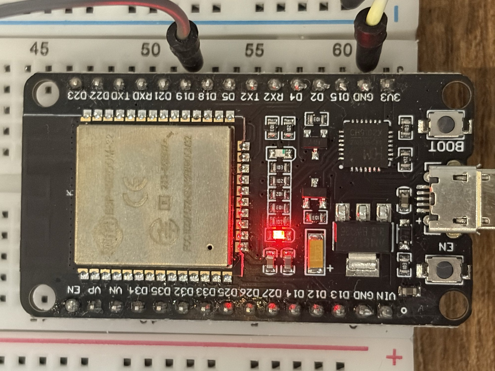

# Hardware inventory

Boards and parts we own, and how they are wired. Keep this up to date: agents
rely on it for pin numbers.

## Boards

| Board | Chip | PlatformIO board ID | USB serial | Notes |
|---|---|---|---|---|
| ESP32 dev board | ESP32-D0WD-V3 rev 3.0 (Xtensa, dual core) | `esp32dev` | `/dev/cu.usbserial-*`, CH343/CH9102 ("USB Single Serial") | On-board LED on GPIO2 |

### ESP32 dev board: details read from the chip

Read with `esptool flash-id` and `espefuse summary` (esptool v5.4.0, from
`~/.platformio/packages/tool-esptool/`) on 2026-11-06.

- Chip: ESP32-D0WD-V3, revision v3.0, 240 MHz, Wi-Fi + Bluetooth (classic and BLE).
- Crystal: 40 MHz. Flash: 4 MB (manufacturer `0x5e`, device `0x4016`), 3.3 V.
- PSRAM: none (D0WD has no in-package PSRAM). That leaves about 320 KB of usable SRAM.
- eFuses: no flash encryption, no secure boot, no custom MAC. ADC Vref is
  calibrated in eFuse (1135 mV).

### ESP32 dev board: physical layout

- **30-pin "DOIT ESP32 DevKit V1" style clone**, with 15 pins per side.
  - Module: ESP-WROOM-32.
  - USB: CH9102X USB-serial chip, micro-USB connector.
  - Buttons: BOOT (GPIO0) and EN (reset).
  - Power: AMS1117 3.3 V regulator.
- **Silkscreen labels are GPIO numbers:** "D4" is GPIO4. The exceptions:

  | Label | GPIO | Note |
  |---|---|---|
  | TXD / RXD | 1 / 3 | USB serial, leave free |
  | TX2 / RX2 | 17 / 16 | UART2 by default, usable as normal GPIOs |
  | VP / VN | 36 / 39 | input-only |
  | EN | – | reset, not a GPIO |
  | VIN | – | 5 V from USB, or an external 5 V supply in |
  | 3V3 | – | 3.3 V regulator output |

- **Pin order**, with the board seen from the top, USB on the right and the module on the left:
  - Top row: D23, D22, TXD, RXD, D21, D19, D18, D5, TX2, RX2, D4, D2, D15, GND, 3V3.
  - Bottom row: EN, VP, VN, D34, D35, D32, D33, D25, D26, D27, D14, D12, D13, GND, VIN.
- **Not brought out to pins:** GPIO0 (the BOOT button only) and GPIO6–11 (flash).
  The ADC1 pins on this board are GPIO32–36 and 39.

## ESP32 pin rules (classic ESP32, any dev board)

Check every pin choice against these rules. Sources, checked on 2026-11-07:

- [DS] ESP32 Series Datasheet v5.3: §3 Boot Configurations, Table 4-6
  Peripheral Pin Configurations, and the pin list.
- [WROOM] ESP32-WROOM-32 Datasheet v3.8: pin table note 2, Tables 12–14
  (electrical).
- [IDF] ESP-IDF ADC documentation. Neither datasheet mentions the ADC2 and Wi-Fi conflict.
- [CORE] The Arduino core's `variants/esp32/pins_arduino.h`, from
  `framework-arduinoespressif32` 4.30312.261024 (installed by espressif32 @ 8.0.0).

The rules:

- **Do not use GPIO6–11.** They are connected to the SPI flash, and using them crashes the
  board. [WROOM]
- **GPIO1 (TX0) and GPIO3 (RX0)** are the USB serial port. Leave them free. [CORE]
- **Input-only: GPIO34, 35, 36 (VP) and 39 (VN).** They have no output driver and no
  internal pull-up or pull-down. GPIO37 and GPIO38 are input-only too, but are not
  brought out to the board's pins. [DS]
- **Strapping pins** are read at reset. Anything wired to them must not pull
  them to the wrong level at boot. [DS §3]
  - GPIO0 (internal pull-up): LOW at boot enters download mode. This is the BOOT button.
  - GPIO2 (internal pull-down): must be LOW or floating to flash. It also drives the on-board LED.
  - GPIO12 / MTDI (internal pull-down): HIGH at boot switches the flash supply
    to 1.8 V. This board's flash runs at 3.3 V, so it then fails to boot.
    Never put a pull-up on it.
  - GPIO15 / MTDO (internal pull-up): LOW at boot silences the boot log.
  - GPIO5 (internal pull-up): sets the SDIO slave timing. It doesn't matter here, but GPIO5 is
    also the default VSPI SS.
- **ADC:** ADC1 is on GPIO32–39 [DS Table 4-6]. ADC2 is on GPIO0, 2, 4, 12–15
  and 25–27 [DS Table 4-6], and **cannot be read while Wi-Fi is on** [IDF].
  Use ADC1 for analog sensors.
- **Logic is 3.3 V and the pins are not 5 V tolerant.** The highest allowed input
  voltage is VDD + 0.3 V, which is 3.6 V. [WROOM Table 14] Any 5 V signal needs a
  divider or a level shifter.
- **Current:** at maximum drive strength a pin can source 40 mA (20 mA for pins in the
  VDD_SDIO domain) and sink 28 mA. [WROOM Table 14] The absolute maximum for all pins
  together is 1100 mA. [WROOM Table 12] An LED with a resistor is fine. Drive relays,
  motors and LED strips through a transistor or driver.
- **Safe general-purpose pins:** GPIO4, 13, 14, 16–19, 21–23, 25–27 and 32–33. Note
  that GPIO16 and 17 are used for PSRAM on WROVER modules, but this board has
  no PSRAM.
- **Arduino-core defaults:** I2C SDA GPIO21 and SCL GPIO22. VSPI MOSI 23,
  MISO 19, SCK 18, SS 5. [CORE]
- **DAC:** GPIO25 and GPIO26. [DS Table 4-6]
- **Touch:** T0–T9 on GPIO4, 0, 2, 15, 13, 12, 14, 27, 33 and 32. [DS Table 4-6]

## Sensors, buttons and other parts

| Part | Quantity | Interface | Notes |
|---|---|---|---|
| 0.96" OLED, 128×64, monochrome | 1 | I2C (pins GND, VCC, SCL, SDA) | SSD1306 at 0x3C (confirmed: the U8g2 SSD1306 driver shows a clean image). Runs from 3.3 V. |
| Mechanical keyboard switch (MX-style, blue keycap) | 1 | 2 metal pins, a plain on/off switch | Pins connect when pressed; either way round. Does not sit in a breadboard (centre post); use female-to-male jumpers. |
| Passive buzzer module (HW-508 / KY-006 style) | 1 | 3 pins: S, middle (unused), − | Passive piezo: needs a tone (PWM), plays any pitch. Driven straight from a GPIO. Full volume (50 % duty) is loud; ~3 % duty (8/255) is comfortable. |
| Analog joystick module (KY-023 style) | 1 | 2× analog + 1 button (pins GND, +5V, VRX, VRY, SW) | Two 10 kΩ pots and a push switch to GND. Despite the label, power it from **3V3** so VRX/VRY stay within 0–3.3 V. SW needs a pull-up. |

## Current wiring

| What | ESP32 pin | Notes |
|---|---|---|
| On-board LED | GPIO2 | Built into the board. |
| External LED with series resistor | GPIO19 → LED → GND | The grey/red and yellow jumpers in the board photo. Confirmed 2026-11-07 with `blink-sos` env `esp32dev-ext-led`. HIGH turns it on. |
| Joystick VRX | GPIO32 | Rests at about 1860, full range 0–4095. |
| Joystick VRY | GPIO33 | Rests at about 1890, full range 0–4095. |
| Joystick SW | GPIO25 | Switch to GND. Use `INPUT_PULLUP`; pressed reads LOW. |
| Joystick GND / +5V | outer rails (− / +) | The + rail is fed from **3V3**, not 5 V. |
| Keyboard switch | GPIO26 → switch → GND | Not currently connected: the jumpers kept falling off. Worked 2026-11-07 with `INPUT_PULLUP` (pressed reads LOW). |
| Buzzer | S → GPIO27, − → outer − rail | Middle pin unconnected. LEDC PWM. Confirmed 2026-11-07 with `stick-dodge` (now `stick-arcade`). |
| OLED SDA / SCL | GPIO21 / GPIO22 | I2C, SSD1306 at 0x3C. |
| OLED GND / VCC | outer rails (− / +) | 3.3 V. |
| Power rails | 3V3 → outer + rail, GND → outer − rail | On the right edge of the right breadboard. |

Layout: the ESP32 straddles two breadboards placed side by side. The VIN…EN row
sits in the left board's outermost column (J) and the 3V3…D23 row in the right
board's column A, so every pin has 4 free holes beside it. On a single
breadboard the VIN…EN row has no free holes. Joystick and OLED confirmed 2026-11-07 with
`projects/joystick-oled`.

The joystick is mounted with its pins facing the ESP32, which puts both raw
axes opposite to the screen's directions. Use `4095 - analogRead(...)` for X
and Y so the stick moves the dot the same way on the screen.

## References

- ESP32 datasheet (pins, strapping, electrical limits): https://www.espressif.com/sites/default/files/documentation/esp32_datasheet_en.pdf
- ESP32-WROOM-32 module datasheet: https://www.espressif.com/sites/default/files/documentation/esp32-wroom-32_datasheet_en.pdf
- ESP32 Technical Reference Manual (registers, peripherals): https://www.espressif.com/sites/default/files/documentation/esp32_technical_reference_manual_en.pdf
- ESP-IDF ADC docs (ADC2 vs Wi-Fi): https://docs.espressif.com/projects/esp-idf/en/stable/esp32/api-reference/peripherals/adc_oneshot.html
- Pinout guide with the "which pins are safe" table: https://randomnerdtutorials.com/esp32-pinout-reference-gpios/
- Arduino-on-ESP32 tutorials per sensor: https://esp32io.com/
- Wokwi simulator diagram format (could let agents test without the board): https://docs.wokwi.com/diagram-format
